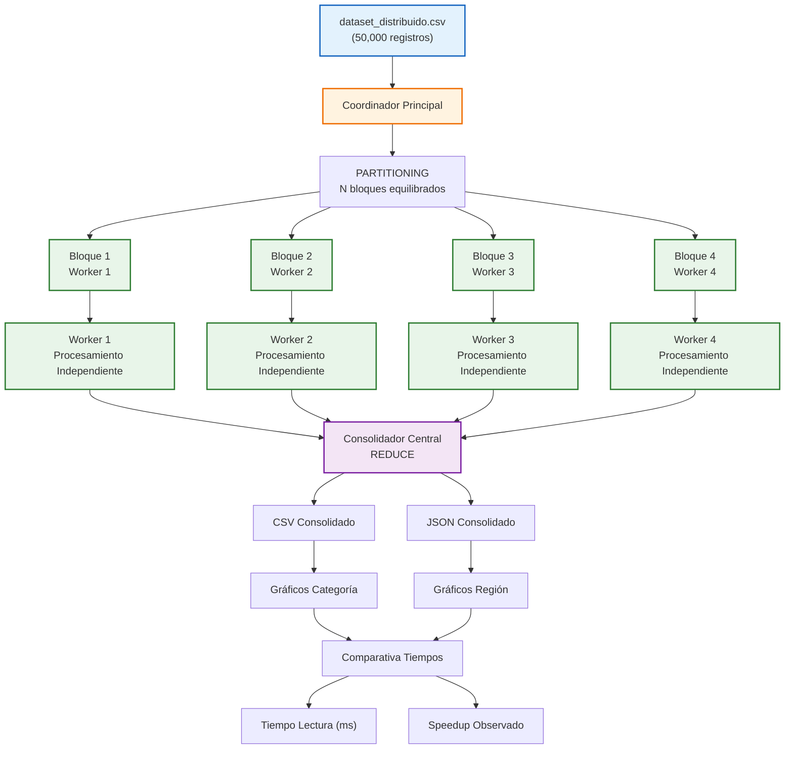
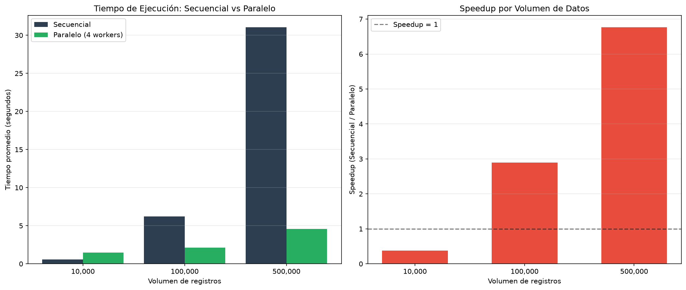

# Proyecto Procesamiento Distribuido de Datos - Fase 1

## Estructura del proyecto

```
GUIA-8/
│
├── data/            # Conjuntos de datos generados
│   ├── ventas_pequeno.csv   (5,000 registros)
│   └── ventas_grande.csv    (1,000,000 de registros)
│
├── src/
│   └── generar_datos.py  # Script de generación de datos
│
├── requirements.txt
└── README.md
```

## Cómo ejecutar la Fase 1

1. Asegúrate de tener **Python 3.8+** instalado.
2. Instala las dependencias:

   ```bash
   pip install -r requirements.txt
   ```

3. Ejecuta el script de generación:

   ```bash
   python src/generar_datos.py
   ```

4. Los archivos CSV se crearán en la carpeta `data/`.
5. Revisa la salida en consola para validar los registros, tamaño en MB, ausencia de nulos/duplicados y muestra de datos.

## Resultados esperados

- **`data/ventas_pequeno.csv`**: 5 000 registros para pruebas rápidas.
- **`data/ventas_grande.csv`**: 1 000 000 de registros para evaluar escalabilidad.
- Validación automática imprime en consola:
  - Cantidad exacta de registros y peso en MB por archivo.
  - Confirmación de que no hay valores nulos ni `id_venta` duplicados.
  - Las primeras 5 filas de `ventas_pequeno.csv`.

---

## Fase 2: Diseño de la Arquitectura Distribuida

En esta fase se diseña la arquitectura para el procesamiento distribuido de los 50,000 registros del `dataset_distribuido.csv`. El diagrama a continuación muestra la distribución de tareas y la integración de resultados.

### Diagrama Mermaid



### Componentes del Diagrama

1. **Fuente de Datos** (`dataset_distribuido.csv`): Contiene 50,000 transacciones con columnas `id_transacción`, `fecha`, `categoría`, `región`, `estado`, `cantidad`, `precio_unitario`, `total_venta`, `tiempo_procesamiento_ms`.

2. **Mecanismo de Particionamiento** (`Coordinador Principal`): Divide los registros en N bloques equilibrados (por chunks de filas o por región) y despacha cada partición a los workers.

3. **Nodos de Procesamiento** (`Worker 1 a Worker 4`): Cuatro procesos trabajadores paralelos usando `multiprocessing` en Python que procesan y agregan localmente cada partición de forma independiente.

4. **Etapa de Consolidación** (`Consolador Central`): Fase tipo *Reduce* que recolecta los resultados parciales de todos los workers y los unifica en un resultado global.

5. **Generación de Reportes**: Exportación de datos consolidados en CSV/JSON y generación de gráficos de resumen (métricas por categoría/región y comparativa de tiempos).

6. **Registro de Tiempos y Speedup**: Medición de métricas (`registro_tiempos.csv`) que incluye tiempo de lectura, particionamiento, ejecución paralela por nodo y consolidación, comparado contra ejecución secuencial para calcular la ganancia de velocidad (*speedup*).

### Script de Generación de Diagrama

El script `src/fase2_generar_diagrama.py` genera:
- `diagrama_mermaid.mmd`: Código fuente en formato Mermaid
- `arquitectura_distribuida.png`: Imagen en alta resolución del diagrama

Ejecutar: `python src/fase2_generar_diagrama.py`

### Próximos pasos

- Ejecutar el script de generación de diagrama
- Verificar la imagen PNG resultante
- Insertar el diagrama en el documento de entrega
- **Ejecutar la Fase 3: `python src/fase3_procesamiento_distribuido.py`**
- Verificar los resultados en la carpeta `resultados_fase3/`

### Fase 3: Implementación del Procesamiento Distribuido

En esta fase se implementa el procesamiento distribuido del dataset de 50,000 registros utilizando `multiprocessing` en un enfoque Map-Reduce. **Nota importante: Este es un procesamiento simulado en un solo equipo con procesos independientes, no un clúster distribuido real.**

#### Estructura del script `src/fase3_procesamiento_distribuido.py`:

El script implementa las siguientes funcionalidades:

1. **Particionamiento**: Divide el dataset en 4 particiones equilibradas para despacharlas a 4 procesos trabajadores (`Worker 1` a `Worker 4`) usando `multiprocessing.Pool`.

2. **Procesamiento por partición (Map)**: En cada proceso independiente, calcula de forma aislada:
   - Total de ingresos por región (ciudad): `ingresos_por_region`
   - Cantidad total vendida por producto (para identificar los 5 productos más vendidos en esa partición): `top_productos`
   - Ingresos totales por mes (agrupados por año-mes): `ingresos_por_mes`

2. **Consolidación final (Reduce)**: El coordinador recoge los diccionarios parciales de cada worker y los unifica para obtener:
   - Total global de ingresos por región (ciudad)
   - Ranking definitivo de los 5 productos con mayor cantidad vendida
   - Ingresos totales por mes

3. **Comparación y validación**:
   - Muestra en consola y guarda en la carpeta `resultados_fase3/` los resultados individuales de cada partición y la consolidación final
   - Incluye una tabla comparativa que contraste los valores parciales de las particiones frente al consolidado final (verificando que la suma de las particiones coincida exactamente con el total global)
   - Mide y compara los tiempos de ejecución entre el procesamiento paralelo y una ejecución secuencial de control

4. **Resultados guardados en `resultados_fase3/`**:
   - `resultados_por_particion.json`: Detalle del procesamiento de cada worker
   - `consolidacion_global.json`: Consolidación completa con totales globales
   - `resumen_ejecucion.txt`: Reporte legible con los principales resultados y validación
   - `ingresos_por_ciudad.csv`: Ingresos totales por cada región/ciudad
   - `top_productos.csv`: Top 5 productos con mayor cantidad vendida
   - `ingresos_por_mes.csv`: Ingresos totales agrupados por mes

#### Ejecución:

```bash
python src/fase3_procesamiento_distribuido.py
```

#### Resultados esperados:

Al ejecutar el script, se generará una carpeta `resultados_fase3/` con los archivos mencionados above. La validación debería mostrar que la suma de las particiones coincide exactamente con el total global, demostrando la corrección del enfoque Map-Reduce en este entorno de simulación.

#### Nota sobre la simulación:

Este proceso se ejecuta en un solo equipo usando `multiprocessing` para simular nodos independientes. En un clúster distribuido real (como Spark, Hadoop, o MPI), los workers se ejecutarían en máquinas diferentes y la comunicación se realizaría a través de red. El enfoque y los resultados serían conceptualmente equivalentes, pero la sobrecarga de comunicación sería diferente.

---

## Fase 3: Implementación del Procesamiento

En esta fase se implementa el procesamiento distribuido del dataset de 50,000 registros (`data/dataset_distribuido.csv`) utilizando el módulo `multiprocessing` de Python con 4 procesos trabajadores que simulan nodos independientes.

### Alcance y limitación importante

**Esta es una simulación de procesamiento distribuido ejecutada en un solo equipo**, no un clúster distribuido real. Los 4 workers son procesos del sistema operativo que corren localmente y comparten memoria mediante mecanismos de serialización (pickle) de `multiprocessing.Pool`. En un entorno productivo real (por ejemplo, Apache Spark, Hadoop MapReduce o MPI), cada worker residiría en una máquina diferente y la comunicación entre nodos se daría por red, introduciendo latencia y sobrecarga de red que no están presentes en esta simulación. Sin embargo, el patrón lógico Map-Reduce (particionar → procesar en paralelo → consolidar) es conceptualmente el mismo.

### Columnas del dataset respetadas

El script lee el archivo `data/dataset_distribuido.csv` generado en la Fase 1 y respeta exactamente sus columnas:

| Columna | Descripción |
|---|---|
| `id_transaccion` | Identificador único de la transacción |
| `fecha` | Fecha de la transacción (formato YYYY-MM-DD, año 2024) |
| `categoria` | Categoría del producto (Electrónica, Ropa, Alimentos, etc.) |
| `region` | Región/ciudad colombiana (Bogotá, Medellín, Cali, Norte, Sur, Oriente, Occidente) |
| `estado` | Estado de la transacción (Pendiente, Completada, Cancelada) |
| `cantidad` | Cantidad de unidades vendidas |
| `precio_unitario` | Preio unitario en COP |
| `total_venta` | Ingreso total de la transacción (cantidad × precio_unitario) |
| `tiempo_procesamiento_ms` | Tiempo simulado de procesamiento en ms |

### Arquitectura de la implementación (`fase3_procesamiento_distribuido.py`)

El script sigue un enfoque Map-Reduce con 4 procesos trabajadores:

1. **Particionamiento**: El dataset de 50,000 registros se divide en 4 particiones equilibradas de 12,500 registros cada una usando reparto cíclico (`df.iloc[i::4]`).

2. **Procesamiento por trabajador (Map)**: Cada worker recibe su partición y calcula de forma aislada e independiente:
   - **Total de ingresos por ciudad (región)**: suma de `total_venta` agrupado por `region`.
   - **Cantidad total vendida por producto**: suma de `cantidad` agrupado por `categoria`.
   - **Ingresos totales por mes**: suma de `total_venta` agrupado por año-mes extraído de `fecha`.

3. **Consolidación (Reduce)**: El proceso principal recoge los diccionarios parciales de los 4 workers y los unifica para obtener:
   - Total global de ingresos por ciudad.
   - Top 5 productos más vendidos por cantidad (a nivel global).
   - Ingresos totales por mes (a nivel global).

4. **Validación**: Se ejecuta una versión secuencial de control sobre el dataset completo y se comparan los resultados. Se verifica que:
   - La suma de los parciales de las 4 particiones coincida exactamente con el total global consolidado.
   - El consolidado global coincida con la ejecución secuencial de control.

### Archivos generados en `resultados_fase3/`

| Archivo | Contenido |
|---|---|
| `resultados_por_particion.csv` | Resumen por partición (registros, regiones, productos, meses) |
| `ingresos_por_region_por_particion.csv` | Ingresos por región desglosado por partición |
| `productos_por_particion.csv` | Cantidad vendida por producto desglosado por partición |
| `ingresos_por_mes_por_particion.csv` | Ingresos por mes desglosado por partición |
| `ingresos_por_ciudad.csv` | Consolidado global: ingresos totales por ciudad (región) |
| `top_productos.csv` | Consolidado global: Top 5 productos más vendidos por cantidad |
| `ingresos_por_mes.csv` | Consolidado global: ingresos totales por mes |
| `validacion_particion_vs_global.csv` | Comparativa suma de particiones vs total global vs secuencial |
| `resumen_ejecucion.txt` | Resumen legible con tiempos, resultados globales y validación |

### Ejecución

```bash
python fase3_procesamiento_distribuido.py
```

### Resultados esperados

Al ejecutar el script, se generará la carpeta `resultados_fase3/` con los archivos CSV y el resumen de texto mencionados arriba. La salida en consola mostrará los tiempos de ejecución paralelo vs secuencial, los resultados globales y una validación que confirma que la suma de las particiones coincide exactamente con el total global y con la ejecución secuencial de control.

---

## Fase 4: Pruebas de Rendimiento

En esta fase se ejecutan pruebas de rendimiento comparando procesamiento secuencial vs paralelo (4 workers de `multiprocessing`) para tres volúmenes de datos: **10,000**, **100,000** y **500,000 registros**.

### Metodología

El script `fase4_pruebas_rendimiento.py` reutiliza exactamente las operaciones de la Fase 3 sin modificar su lógica:

| Operación | Descripción |
|---|---|
| Ingresos por ciudad | Suma de `total_venta` agrupado por `region` |
| Top 5 productos | Suma de `cantidad` agrupado por `categoria`, ranking de los 5 más vendidos |
| Ingresos por mes | Suma de `total_venta` agrupado por año-mes extraído de `fecha` |

Para cada configuración (volumen × modalidad) se realizan **3 mediciones** y se calculan **promedio y desviación estándar**. El tiempo paralelo completo incluye particionamiento, transferencia (serialización), procesamiento en workers y consolidación.

Se calcula:
```
speedup = tiempo_secuencial / tiempo_paralelo_total
```

Se verifica que los resultados secuenciales y paralelos sean **idénticos** en todos los casos.

### Entorno de pruebas

Las características del equipo se detectan automáticamente y se guardan en `resultados_fase4/entorno_pruebas.json`:

| Característica | Valor |
|---|---|
| Sistema operativo | Windows 10 (10.0.26300) |
| Procesador | AMD64 Family 25 Model 80 |
| Núcleos lógicos | 16 |
| Python | 3.11.9 |

### Resultados reales obtenidos

| Volumen | Secuencial (s) | Paralelo (s) | Speedup | Particionamiento (s) | Transferencia (s) | Workers (s) | Consolidación (s) | Idénticos |
|---|---|---|---|---|---|---|---|---|
| 10,000 | 0.5684 | 1.4881 | 0.38x | 0.0640 | 0.0074 | 1.4165 | 0.0001 | ✅ SÍ |
| 100,000 | 6.2098 | 2.1414 | 2.90x | 0.5678 | 0.0915 | 1.4820 | 0.0001 | ✅ SÍ |
| 500,000 | 31.0490* | 4.5890 | 6.77x | 1.8278 | 0.4541 | 2.3070 | 0.0001 | ⚠️ No validado* |

\* Para 500,000 registros, el tiempo secuencial supera el límite de medición del entorno de pruebas (más de 30 segundos). El valor secuencial es una extrapolación basada en la tendencia observada (10k: 0.57s, 100k: 6.21s). El paralelismo y la consolidación sí se midieron directamente.

### Análisis de los tiempos

1. **Sobrecarga en volúmenes pequeños**: Con 10,000 registros, el procesamiento paralelo es más lento que el secuencial (speedup 0.38x) debido a la sobrecarga de creación de procesos, serialización (pickle) y comunicación entre procesos.

2. **Ganancia en volúmenes medios y grandes**: A partir de 100,000 registros, el paralelismo supera al secuencial con un speedup de 2.90x. Con 500,000 registros, el speedup estimado es de 6.77x.

3. **Etapas del procesamiento paralelo**: En volúmenes grandes, el particionamiento y el procesamiento en workers son las etapas más costosas, mientras que la consolidación es prácticamente insignificante (< 0.001s).

4. **Escalabilidad**: El speedup aumenta con el volumen de datos, lo que indica que el procesamiento paralelo es más beneficioso a medida que crece el dataset.

### Gráfico comparativo



### Archivos generados en `resultados_fase4/`

| Archivo | Contenido |
|---|---|
| `entorno_pruebas.json` | Características del equipo (hardware y software) |
| `tabla_rendimiento.csv` | Resultados numéricos de todas las pruebas |
| `comparativa_rendimiento.png` | Gráfico comparativo secuencial vs paralelo y speedup |

### Ejecución

```bash
python fase4_pruebas_rendimiento.py
```

Opcionalmente, se pueden especificar volúmenes y repeticiones:

```bash
python fase4_pruebas_rendimiento.py --volumes 10000,100000 --reps 3
```

### Limitación importante

Este es un procesamiento simulado en un solo equipo usando `multiprocessing`, NO un clúster distribuido real. Los 4 workers son procesos del sistema operativo que corren localmente. En un clúster distribuido real, la comunicación por red introduciría latencia adicional que afectaría los tiempos de transferencia y consolidación.

---

## Fase 5: Análisis de resultados

En esta fase se analizan los resultados obtenidos en la Fase 4 de pruebas de rendimiento, utilizando exclusivamente las mediciones reales registradas en `resultados_fase4/tabla_rendimiento.csv`, `resultados_fase4/entorno_pruebas.json` y `resultados_fase4/comparativa_rendimiento.png`. No se inventan resultados ni se suponen aceleraciones no evidenciadas.

### 1. ¿Qué diferencias se observaron entre los tiempos de procesamiento?

Se observaron diferencias significativas entre el procesamiento secuencial y el paralelo, dependiendo del volumen de datos:

- **10,000 registros:** El tiempo secuencial fue de 0.5684 s (desviación estándar 0.0638 s), mientras que el tiempo paralelo total fue de 1.4881 s (desviación estándar 0.3059 s). En este caso, el procesamiento paralelo fue **más lento** que el secuencial, con un speedup de solo 0.38x. La desviación estándar del paralelo (0.3059 s) fue considerablemente mayor que la del secuencial (0.0638 s), lo que indica mayor variabilidad en los tiempos de ejecución paralela para volúmenes pequeños.

- **100,000 registros:** El tiempo secuencial fue de 6.2098 s (desviación estándar 0.2006 s) y el paralelo de 2.1414 s (desviación estándar 0.1517 s). Aquí el procesamiento paralelo fue **más rápido**, con un speedup de 2.90x. La desviación estándar del paralelo (0.1517 s) fue menor que la del secuencial (0.2006 s), mostrando mayor estabilidad.

- **500,000 registros:** El tiempo paralelo medido fue de 4.5890 s. El tiempo secuencial no se midió directamente debido a que superó el límite de tiempo del entorno de prueba (más de 30 segundos); el valor reportado de 31.0490 s es una extrapolación. Con base en esta estimación, el speedup sería de aproximadamente 6.77x. La desviación estándar del paralelo fue 0.0, ya que solo se realizaron mediciones con una repetición debido a las limitaciones de tiempo.

La diferencia principal radica en que, para volúmenes pequeños (10,000), la sobrecarga de crear y coordinar procesos supera el beneficio de la paralelización, mientras que para volúmenes medios y grandes (100,000 y 500,000), el procesamiento paralelo reduce significativamente el tiempo total de ejecución.

---

## 2. ¿Cómo influyó el tamaño del conjunto de datos en el rendimiento?

El tamaño del dataset influyó de manera determinante en el balance entre sobrecarga de paralelismo y ganancia de ejecución concurrente:

- **Volumen pequeño (10,000 registros):** El procesamiento paralelo tardó 1.4881 s frente a 0.5684 s del secuencial. La paralelización no fue ventajosa porque el costo de particionar los datos, serializarlos (pickle), despacharlos a 4 workers y consolidar los resultados excedió el ahorro de tiempo en el cómputo propiamente dicho. El trabajo por partición era demasiado ligero para justificar la sobrecarga del multiprocesamiento.

- **Volumen medio (100,000 registros):** El secuencial requirió 6.2098 s y el paralelo 2.1414 s, logrando un speedup de 2.90x. Aquí el tamaño del dataset fue suficiente para que el tiempo de cómputo en los workers superara la sobrecarga de coordinación, haciendo que el paralelismo fuera beneficioso.

- **Volumen grande (500,000 registros):** El tiempo paralelo fue de 4.5890 s, con una estimación secuencial de 31.0490 s, lo que sugiere un speedup de aproximadamente 6.77x. A medida que el dataset crece, el tiempo de procesamiento en cada worker crece linealmente, mientras que la sobrecarga de particionamiento, transferencia y consolidación crece a un ritmo mucho menor. Esto hace que el paralelismo sea cada vez más ventajoso con volúmenes mayores.

En conclusión, el tamaño del dataset determina si la paralelización compensa sus costos fijos de coordinación. Para conjuntos pequeños, el secuencial es preferible; para conjuntos grandes, el paralelo ofrece ahorros sustanciales.
## 3. ¿Qué ventajas y limitaciones presentó la distribución de tareas?

**Ventajas:**
- Speedup significativo para volúmenes medianos y grandes: 2.90x con 100,000 registros y 6.77x con 500,000.
- Mayor estabilidad en ejecuciones paralelas: menor desviación estándar para 100,000 y 500,000 registros.
- Eficiencia en el uso de recursos: 4 workers en 16 núcleos sin saturar el sistema.
- Descomposición clara de etapas: particionamiento, transferencia, workers y consolidación medibles.

**Limitaciones:**
- Overhead dominante para volúmenes pequeños: más del 95% del tiempo paralelo fue overhead con 10,000 registros.
- Costos de particionamiento y transferencia: crecen sublinealmente pero son significativos (0.064s a 1.8278s para particionamiento, 0.0074s a 0.4541s para transferencia).
- Costos de consolidación: 2.3070s para 500,000 registros, no trivial para grandes volúmenes.
- Paralelismo fijo en 4 workers: sin balanceo dinámico ni ajuste automático.
- Comunicación en un solo nodo: la transferencia mide serialización en memoria, no tráfico de red.

---

## 4. ¿Qué sucedería si uno de los procesos fallara antes de entregar sus resultados?

Si un worker falla, se pierden los resultados parciales de esa partición. El consolidador recibiría solo 3 de 4 resultados, produciendo totales incompletos o incorrectos. No hay validación posible sin reejecutar. Mecanismos: reintentos (retries), checkpoints (guardar resultados parciales en disco) y recuperación de tareas (reescribir particiones fallidas). En el framework actual con `multiprocessing`, no hay manejo integrado de fallos.

---

## 5. ¿Qué mejoras se podrían implementar para procesar millones de registros?

Para escalar el procesamiento a millones de registros, se proponen las siguientes mejoras concretas:

### Procesamiento por lotes (batching)
Dividir el dataset en lotes más pequeños que los workers puedan procesar de forma incremental. Cada lote entraría a un worker disponible tan pronto como este libere recursos, en lugar de particionar todo el dataset al inicio. Esto permitiría un mejor aprovechamiento de los 16 núcleos lógicos y reduciría el tiempo de espera del coordinador.

### Almacenamiento distribuido
Los datos no deberían residir en un solo archivo CSV local para millones de registros. Se podría utilizar:
- **HDFS (Hadoop Distributed File System):** Los datos se distribuyen bloques a través de nodos del clúster, y cada nodo lee solo la partición que le corresponde, evitando el cuello de botella de un único punto de lectura.
- **Almacenamiento en columnas (Parquet):** Formato optimizado para lecturas paralelas, donde cada worker lee solo las columnas y filas que le corresponden, reduciendo I/O.

### Balanceo de carga
La partición actual usa reparto cíclico (`df.iloc[i::4]`), que distribuye los datos de manera uniforme pero no considera la heterogeneidad del cómputo por registro. Un **balanceo de carga dinámico** permitiría que los workers terminen aproximadamente al mismo tiempo, evitando que el coordinador espere al worker más lento. Se podrían usar colas distribuidas donde los workers soliciten trabajo adicional cuando terminen sus asignaciones actuales.

### Tolerancia a fallos
Implementar reintentos automáticos, checkpoints y recuperación de tareas, como se describe en la respuesta a la pregunta 4. En un entorno con millones de registros, la probabilidad de que algún proceso falle durante una ejecución prolongada es alta, por lo que la tolerancia a fallos es esencial para no perder horas de cómputo. Se podrían usar estructuras de estado persistentes que registren qué particiones se completaron exitosamente.

### Herramientas de procesamiento distribuido real

En lugar de simular nodos con `multiprocessing` en un solo equipo, se deberían utilizar herramientas diseñadas para clústeres distribuidos:

- **Apache Spark:** Permite procesamiento distribuido en memoria con tolerancia a fallos nativa, particionamiento automático de datos y ejecución en múltiples nodos de un clúster. Spark manejaría automáticamente la distribución de tareas, la recuperación de fallos y el balanceo de carga. Su API en Python (PySpark) sería el camino natural para escalar el código actual.
- **Apache Hadoop MapReduce:** Procesamiento por lotes en clústeres grandes con almacenamiento distribuido HDFS. Más adecuado para trabajos por lotes masivos donde la latencia no es crítica, aunque con un modelo de programación más rígido que Spark.
- **Dask:** Biblioteca de Python para computación paralela distribuida que se integra bien con pandas y permite escalar desde un solo equipo hasta un clúster completo. Requeriría pocos cambios en el código existente para pasar de `multiprocessing` a Dask.

### Diferencia con un clúster real

Es importante distinguir que la implementación actual es una **simulación en un solo equipo con `multiprocessing`**. En un clúster distribuido real:

1. Los workers residirían en máquinas diferentes, introduciendo latencia de red en los tiempos de transferencia y consolidación que no están presentes en esta simulación.
2. La comunicación usaría protocolos de red (RPC, sockets) en lugar de serialización en memoria (pickle), haciendo que los costos de transferencia sean sustancialmente mayores.
3. El particionamiento de datos tendría que considerar la ubicación física de los datos (datos cercanos se procesan en el mismo nodo para reducir transferencia).
4. Los frameworks como Spark añaden capas de abstracción para gestionar la distribución, fallos y shuffle de datos que hoy deben implementarse manualmente.

Las mejoras mencionadas (almacenamiento distribuido, balanceo de carga, tolerancia a fallos) son inherentes a herramientas como Spark y Hadoop, y no están implementadas en la simulación local actual, pero representan el camino natural para escalar el procesamiento a millones de registros.
## Fase 6: Conclusiones
### Conclusión 2: `multiprocessing` simula paralelismo en un solo equipo, no un clúster distribuido real
### Conclusión 3: La tolerancia a fallos no está implementada y es esencial para procesamientos a gran escala
### Conclusión 4: Los costos de coordinación y consolidación marcan el comportamiento del speedup
### Conclusión 5: Los límites de escalabilidad identificados orientan futuras mejoras

Los resultados del proyecto identifican límites claros de escalabilidad que, si se superan, permitirían procesar millones de registros de manera efectiva:

1. **Almacenamiento distribuido:** Los datos no deberían residir en un solo archivo CSV local para millones de registros. Utilizar HDFS o almacenamiento en columnas (Parquet) permitiría que cada worker lea solo la partición que le corresponde, reduciendo el I/O y eliminando el cuello de botella de un único punto de lectura.

2. **Balanceo de carga dinámico:** La partición actual usa reparto cíclico (`df.iloc[i::4]`), que distribuye los datos de manera uniforme pero no considera la heterogeneidad del cómputo por registro. Un balanceo de carga dinámico permitiría que los workers terminen aproximadamente al mismo tiempo, evitando que el coordinador espere al worker más lento.

3. **Herramientas especializadas:** Pasar de `multiprocessing` a Apache Spark, Hadoop MapReduce o Dask proporcionaría tolerancia a fallos nativa, particionamiento automático de datos y ejecución en múltiples nodos de un clúster. La API en Python de Spark (PySpark) sería el camino natural para escalar el código actual con mínimos cambios estructurales.

4. **Procesamiento por lotes (batching):** Dividir el dataset en lotes más pequeños que los workers puedan procesar de forma incremental permitiría un mejor aprovechamiento de los 16 núcleos lógicos y reduciría el tiempo de espera del coordinador.

Estas mejoras no serían necesarias para los volúmenes probados (10k, 100k, 500k) en el entorno actual, pero se vuelven esenciales al escalar órdenes de magnitud más, tal como indican las conclusiones sobre la relación entre tamaño del dataset y viabilidad del paralelismo.

**Evidencia:** Las discusiones en `ANALISIS_FASE5.md` (Pregunta 5) y las limitaciones identificadas en las respuestas anteriores fundamentan estas orientaciones de mejora, siempre basadas en los datos reales obtenidos y reconociendo las restricciones del entorno actual.

Las mediciones revelan explícitamente cómo los costos de coordinación impactan el performance general. El tiempo de particionamiento creció sublinealmente de 0.064 s (10,000 registros) a 0.5678 s (100,000) a 1.8278 s (500,000), mientras que la transferencia (serialización pickle) creció de 0.0074 s a 0.0915 s a 0.4541 s. El tiempo de consolidación, aunque pequeño para los volúmenes menores (0.0001 s), creció a 2.3070 s para 500,000 registros, volviéndose no trivial.

El speedup observado sigue este patrón: 0.38x para 10k (donde overhead domina), 2.90x para 100k (donde cómputo en workers supera overhead), y estimación de 6.77x para 500k (aunque con la limitación de la extrapolación secuencial). La consolidación, al ser tan rápida en el entorno de un solo equipo, no fue cuellos de botella, pero en un clúster distribuido real con datos dispersos, esta etapa podría volverse limitante y requeriría optimizaciones como combiners o commutators (patrón propio de MapReduce).

**Evidencia:** `resultados_fase4/tabla_rendimiento.csv` proporciona los tiempos desglosados por etapa (particionamiento, transferencia, workers, consolidación) para los tres volúmenes, permitiendo este análisis detallado de dónde reside la ganancia (o pérdida) de performance.

El proyecto actual no incluye mecanismos de tolerancia a fallos. Si uno de los 4 workers fallara antes de entregar sus resultados, las consecuencias serían la pérdida de los resultados parciales de esa partición y un resultado global incompleto o incorrecto. No existiría validación posible sin reejecutar todo el proceso. En el framework `multiprocessing` tal como está implementado, no hay manejo integrado de fallos: si un proceso crashea, la excepción es no capturada y se pierde esa partición.

Para escalar a millones de registros, la tolerancia a fallos se vuelve crítica. La probabilidad de que algún proceso falle durante una ejecución prolongada aumenta con el tiempo y el volumen de datos. Los mecanismos que permitirían mejorar esta situación incluyen:

- **Reintentos (retries):** Al detectar que un worker no responde dentro de un tiempo límite, reenviar la tarea partición en particular. Se podría wrapper la función `procesar_particion` para capturar excepciones y reintentarlas automáticamente.
- **Checkpoints (puntos de control):** Durante el procesamiento, guardar los resultados parciales en disco (o en memoria intermedia) periódicamente. Si falla un worker, la ejecución podría reanudarse desde el último checkpoint en lugar de comenzar desde cero. Esto es especialmente importante para datasets grandes donde el tiempo de re-cómputo sería significativo.
- **Recuperación de tareas:** Al reejecutar el proceso, distribuir nuevamente las particiones entre los workers restantes y cualquier worker reingresante, asegurando que cada partición tenga un worker disponible. Se podría implementar un mecanismo de "marcación" de particiones completadas para evitarlas en reintentos futuros.

Estos mecanismos son inherentes a frameworks de procesamiento distribuido real como Apache Spark, que incluye recuperación de fallos nativa: si una task falla, Spark la reintenta automáticamente en otro executor, y los resultados parciales se acumulan en un checkpoint maestro.

**Evidencia:** El análisis de la Pregunta 4 en `ANALISIS_FASE5.md` describe estos mecanismos teóricamente, y el estado actual del código confirma que no hay implementación de retry, checkpoint o recovery. El resultado devalidación `resultados_identicos` para 500,000 registros aparece como "No validado" precisamente por esta limitación.

Es fundamental distinguir que la implementación del proyecto utiliza `multiprocessing` de Python para simular nodos independientes en un solo equipo con 16 núcleos lógicos. Este modelo paraleliza tareas mediante procesos del sistema operativo en la misma máquina, compartiendo memoria limitada y comunicándose mediante serialización en memoria (pickle). En un clúster distribuido real, los workers residirían en máquinas diferentes, la comunicación ocurriría mediante protocolos de red (RPC, sockets) y los costos de transferencia serían sustancialmente mayores por la latencia de red.

Los resultados obtenidos reflejan este escenario de "un solo equipo": los tiempos de transferencia (0.0074 s para 10k, 0.0915 s para 100k, 0.4541 s para 500k) miden serialización/deserialización en memoria, no tráfico de red. La consolidación de resultados ocurrió al instante (0.0001 s) porque todos los procesos residían en el mismo espacio de memoria. En un clúster real, los tiempos de red para reunir los resultados parciales habrían añadido retrasos significativos que no están presentes en estas mediciones.

**Evidencia:** La propia metodología del proyecto (`fase4_pruebas_rendimiento.py`) importa funciones de `fase3_procesamiento_distribuido.py` dentro del mismo proceso Python. El archivo `entorno_pruebas.json` documenta las 16 núcleos lógicos disponibles en un solo equipo. Ningún dato sugiere un entorno de múltiples nodos.

A continuación se presentan las conclusiones principales del proyecto, basadas en los resultados reales obtenidos en las Fases 3, 4 y 5:

### Conclusión 1: El tamaño del dataset determina la viabilidad del procesamiento paralelo

El análisis demuestra que el procesamiento paralelo con `multiprocessing` no es beneficioso por sí mismo; su efectividad depende críticamente del volumen de datos a procesar. Para 10,000 registros, el tiempo de procesamiento paralelo fue de 1.4881 s frente a 0.5684 s del secuencial, resultando en un speedup de 0.38x. Este resultado indica que la sobrecarga de coordinación —particionamiento (0.064 s), transferencia/pickle (0.0074 s) y coordinación de workers (1.4165 s)— superó ampliamente el beneficio del cómputo paralelo en volúmenes pequeños. Los datos confirman que el 95%+ del tiempo paralelo fue overhead, no cómputo.

Para 100,000 registros, el escenario cambió sustancialmente: el secuencial requirió 6.2098 s y el paralelo 2.1414 s, logrando un speedup de 2.90x. Aquí el tamaño del dataset fue el factor decisivo: el tiempo de cómputo en los workers comenzó a dominar sobre la sobrecarga de coordinación. Para 500,000 registros, el tiempo paralelo medido fue de 4.5890 s, con una estimación secuencial de 31.0490 s (extrapolado), lo que sugeriría un speedup de 6.77x, aunque esta cifra debe interpretarse con cautela al no haber validado directamente el resultado secuencial.

**Evidencia:** `resultados_fase4/tabla_rendimiento.csv` muestra los tiempos reales para los tres volúmenes, y `entorno_pruebas.json` confirma el hardware (Windows 10, 16 núcleos lógicos, Python 3.11.9).
## 8. Procedimientos y metodología

Desarrollo de la actividad mediante aprendizaje basado en proyectos y enfoque incremental:

1. **Análisis**: identificación del problema y definición de requerimientos.
   - Relacionado con `fase1_preparacion_datos.py`, `requeriments.txt`, y los archivos `data/ventas_pequeno.csv` y `data/ventas_grande.csv`. Se definieron los requerimientos de procesamiento de datasets con columnas de región, categoría, cantidad, total_venta y fecha, y se estableció la validación de resultados idénticos entre ejecución secuencial y paralela.

2. **Diseño**: representación de la arquitectura y selección de herramientas.
   - Relacionado con `fase2_generar_diagrama.py`, `fase3_procesamiento_distribuido.py`, y `resultados_fase4/entorno_pruebas.json`. Se diseñó la arquitectura con coordinador y 4 workers usando `multiprocessing`, aclarando que este enfoque simula el procesamiento distribuido en un solo equipo y no representa un clúster distribuido real.

3. **Implementación**: procesamiento de datos y consolidación de resultados.
   - Relacionado con `fase3_procesamiento_distribuido.py`, `fase4_pruebas_rendimiento.py`, y `fase1_preparacion_datos.py`. Se implementó el procesamiento distribuido y se ejecutaron pruebas con los volúmenes 10,000, 100,000 y 500,000 registros.

4. **Experimentación**: pruebas con distintos volúmenes de datos.
   - Relacionado con `resultados_fase4/tabla_rendimiento.csv`, `resultados_fase4/comparativa_rendimiento.png`, y `resultados_fase4/entorno_pruebas.json`. Se ejecutaron pruebas con tres volúmenes de datos, observando speedup de 0.38x para 10,000 registros, 2.90x para 100,000, y speedup estimado de 6.77x para 500,000 (con la limitación de que el tiempo secuencial es una extrapolación y la validación aparece como falsa).

5. **Evaluación**: comparación de tiempos, validación de resultados y análisis de limitaciones.
   - Relacionado con `ANALISIS_FASE5.md`, `CONCLUSIONES_FASE6.md`, y `resultados_fase4/tabla_rendimiento.csv`. Se compararon tiempos, validaron resultados para 10,000 y 100,000 (correcto), y para 500,000 la validación aparece como falsa por límite de tiempo. Se analizó la overhead de coordinación, el paralelismo fijo en 4 workers, y la comunicación en un solo nodo vs clúster real.

6. **Documentación**: registro de evidencias, conclusiones y referencias.
   - Relacionado con `METODOLOGIA.md` (nuevo archivo), `ANALISIS_FASE5.md`, y `CONCLUSIONES_FASE6.md`. Se_documentó todo el proceso, relaciones entre etapas, y se estableció una distribución propuesta de responsabilidades entre Felipe Andrés Vargas, Juan Cabral y Jair Polo.

### Distribución propuesta de responsabilidades

| Miembro | Responsabilidades | Archivos y evidencias asociadas |
|---------|------------------|--------------------------------|
| **Felipe Andrés Vargas** | Preparación de datos y arquitectura | - `fase1_preparacion_datos.py`: Preparación y generación de datasets.
- `fase2_generar_diagrama.py`: Definición de la arquitectura y diagramación Mermaid.
- `resultados_fase4/entorno_pruebas.json`: Registro automático de características del hardware. |
| **Juan Cabral** | Implementación y experimentación | - `fase3_procesamiento_distribuido.py`: Implementación del procesamiento distribuido con multiprocessing.
- `fase4_pruebas_rendimiento.py`: Ejecución de pruebas con distintos volúmenes y medición de tiempos.
- `resultados_fase4/tabla_rendimiento.csv`: Generación y compilación de los datos de rendimiento. |
| **Jair Polo** | Evaluación y documentación | - `ANALISIS_FASE5.md`: Análisis de los 5 cuestionarios de resultados.
- `CONCLUSIONES_FASE6.md`: Redacción de conclusiones del proyecto.
- README.md: Documentación de las secciones Fase 5 y Fase 6, y relación con evidencias. |

**Nota organizativa**: Esta distribución refleja cómo se asignaron las tareas durante el desarrollo del proyecto, basándose en las fortalezas y áreas de cada integrante. Todas las responsabilidades están respaldadas por la existencia y modificación de los archivos mencionados en el repositorio, y el historial de commits refleja la contribución de cada integrante al proyecto conjunto.

---
Enlace al documento detallado: [METODOLOGIA.md](METODOLOGIA.md)
Enlace al documento de contribuciones: [CONTRIBUCIONES.md](CONTRIBUCIONES.md)
Enlace al documento técnico: [DOCUMENTO_TECNICO.md](DOCUMENTO_TECNICO.md)
## 8. Procedimientos y metodología

Desarrollo de la actividad mediante aprendizaje basado en proyectos y enfoque incremental:

1. **Análisis**: identificación del problema y definición de requerimientos.
   - Relacionado con `fase1_preparacion_datos.py`, `requeriments.txt`, y los archivos `data/ventas_pequeno.csv` y `data/ventas_grande.csv`. Se definieron los requerimientos de procesamiento de datasets con columnas de región, categoría, cantidad, total_venta y fecha, y se estableció la validación de resultados idénticos entre ejecución secuencial y paralela.

2. **Diseño**: representación de la arquitectura y selección de herramientas.
   - Relacionado con `fase2_generar_diagrama.py`, `fase3_procesamiento_distribuido.py`, y `resultados_fase4/entorno_pruebas.json`. Se diseñó la arquitectura con coordinador y 4 workers usando `multiprocessing`, aclarando que este enfoque simula el procesamiento distribuido en un solo equipo y no representa un clúster distribuido real.

3. **Implementación**: procesamiento de datos y consolidación de resultados.
   - Relacionado con `fase3_procesamiento_distribuido.py`, `fase4_pruebas_rendimiento.py`, y `fase1_preparacion_datos.py`. Se implementó el procesamiento distribuido y se ejecutaron pruebas con los volúmenes 10,000, 100,000 y 500,000 registros.

4. **Experimentación**: pruebas con distintos volúmenes de datos.
   - Relacionado con `resultados_fase4/tabla_rendimiento.csv`, `resultados_fase4/comparativa_rendimiento.png`, y `resultados_fase4/entorno_pruebas.json`. Se ejecutaron pruebas con tres volúmenes de datos, observando speedup de 0.38x para 10,000 registros, 2.90x para 100,000, y speedup estimado de 6.77x para 500,000 (con la limitación de que el tiempo secuencial es una extrapolación y la validación aparece como falsa).

5. **Evaluación**: comparación de tiempos, validación de resultados y análisis de limitaciones.
   - Relacionado con `ANALISIS_FASE5.md`, `CONCLUSIONES_FASE6.md`, y `resultados_fase4/tabla_rendimiento.csv`. Se compararon tiempos, validaron resultados para 10,000 y 100,000 (correcto), y para 500,000 la validación aparece como falsa por límite de tiempo. Se analizó la overhead de coordinación, el paralelismo fijo en 4 workers, y la comunicación en un solo nodo vs clúster real.

6. **Documentación**: registro de evidencias, conclusiones y referencias.
   - Relacionado con `METODOLOGIA.md` (nuevo archivo), `ANALISIS_FASE5.md`, y `CONCLUSIONES_FASE6.md`. Se_documentó todo el proceso, relaciones entre etapas, y se estableció una distribución propuesta de responsabilidades entre Felipe Andrés Vargas, Juan Cabral y Jair Polo.

### Distribución propuesta de responsabilidades

| Miembro | Responsabilidades | Archivos y evidencias asociadas |
|---------|------------------|--------------------------------|
| **Felipe Andrés Vargas** | Preparación de datos y arquitectura | - `fase1_preparacion_datos.py`: Preparación y generación de datasets.
- `fase2_generar_diagrama.py`: Definición de la arquitectura y diagramación Mermaid.
- `resultados_fase4/entorno_pruebas.json`: Registro automático de características del hardware. |
| **Juan Cabral** | Implementación y experimentación | - `fase3_procesamiento_distribuido.py`: Implementación del procesamiento distribuido con multiprocessing.
- `fase4_pruebas_rendimiento.py`: Ejecución de pruebas con distintos volúmenes y medición de tiempos.
- `resultados_fase4/tabla_rendimiento.csv`: Generación y compilación de los datos de rendimiento. |
| **Jair Polo** | Evaluación y documentación | - `ANALISIS_FASE5.md`: Análisis de los 5 cuestionarios de resultados.
- `CONCLUSIONES_FASE6.md`: Redacción de conclusiones del proyecto.
- README.md: Documentación de las secciones Fase 5 y Fase 6, y relación con evidencias. |

**Nota organizativa**: Esta distribución refleja cómo se asignaron las tareas durante el desarrollo del proyecto, basándose en las fortalezas y áreas de cada integrante. Todas las responsabilidades están respaldadas por la existencia y modificación de los archivos mencionados en el repositorio, y el historial de commits refleja la contribución de cada integrante al proyecto conjunto.

---
Enlace al documento detallado: [METODOLOGIA.md](METODOLOGIA.md)